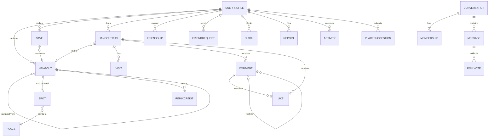

# Vybe: Data Model and Storage

Status: proposal (3 Nov 2026), from the team's decisions (`docs/PRODUCT.md` section 4) and research into Apple's, Firebase's and
Supabase's documentation. Sources at the end. Items marked **(decide)** need a team answer and are also in `docs/OPEN-QUESTIONS.md`.

---

## 1. Where data lives

| Data | Phase 1 (frontend, sample data) | Phase 2 (with a backend) |
|---|---|---|
| Places and Picks (team content) | JSON files bundled in the app (read-only) | backend database |
| Saved Hangouts, Drafts, Hangout runs | one JSON file `Application Support/Vybe/library.json` | backend; the **live run** stays in `library.json` until it ends |
| Photos from a run | JPEG files in `Application Support/Vybe/photos/<runID>/` | uploaded to backend storage; a small photo cache on the phone |
| Name and photo from onboarding | `profile.json` + an image file | backend profile |
| Small settings (onboarding done, chosen area, interests) | `UserDefaults` through `Core/Services/AppSettings` (not `@AppStorage`: SwiftUI-only) | same |
| Login tokens | none | kept by the backend SDK in the Keychain (we never store tokens ourselves) |
| Offline copy of what you last saw | not needed (everything is local) | Firebase: built-in cache. Supabase: our own JSON cache files |

### Why no database on the phone (SwiftData, Core Data)

| Option | Verdict | Reason |
|---|---|---|
| **Plain JSON files** (Codable) | **Use** | Our models are already `Codable` structs. One file, written atomically, is simple and testable. |
| UserDefaults (via `AppSettings`) | Only small settings | Apple: stored unencrypted; personal data belongs elsewhere. |
| Keychain | Only secrets | Built for passwords and tokens, not app data. |
| **SwiftData** | **Not now** | (1) `@Query` only works inside a SwiftUI View (Apple engineer, Developer Forums, checked), which breaks our rule that Views don't load data. (2) `@Model` objects are classes and not `Sendable`, so every model would need a second copy. (3) iOS 18 brought memory and behaviour problems; several well-known developers went back to Core Data. (4) Our server will be the source of truth: a local database is a second copy to keep in sync. |
| Core Data | Not now | Powerful but wordy, and the same "second copy" problem. |

Confidence: high for Phase 1; medium-high for Phase 2 if we pick Firebase, whose cache is on by default on iOS (100 MB) and tells us
when data came from the cache (checked). With Supabase (no cache), revisit only if offline search becomes a real need.

## 2. Conventions every model follows

| Topic | Rule |
|---|---|
| **IDs** | Always `String` in files and the database. In Swift wrapped as `ID<Tag>` so a `PlaceID` can't be passed where a `HangoutID` is expected. |
| Team content IDs | `place-<slug>-<4 random chars>`, `hangout-<slug>-<4 random chars>`, made by the K1 script. **Never changed**, even if the name changes. |
| User content IDs | random lower-case UUID made on the phone (safe to retry; works in Firestore and Postgres). Never counting-up numbers (Firestore warns they cause slowdowns). |
| `UserID` | the backend's login user ID (a string). |
| **Times** | `Date` in Swift; ISO 8601 UTC in JSON (`"2026-11-03T10:00:00Z"`). Important times (`createdAt`, `postedAt`) are set by the server, because phone clocks can be wrong. |
| Opening hours | weekday number (1 = Sunday, like Apple's Calendar) + `"HH:mm"` in Pune time. |
| **Money** | whole rupees as `Int`, as a range per person: `RupeeRange { lower, upper }`. Never `Double`. Shown with `.formatted(.currency(code: "INR"))`. |
| **Coordinates** | our own `Coordinate { latitude, longitude }` (Apple's `CLLocationCoordinate2D` is not `Codable` and would pull map code into Models). |
| **Fixed states** (draft, live, done...) | real Swift `enum`s stored as strings. |
| **Lists the team grows** (category, tags, report reasons) | string-backed types, so an unknown value from newer data can't crash an older app. |
| **Versioning** | every JSON file has `schemaVersion: Int`. New fields are optional, so older app builds still load newer data. |
| **Soft delete** | `deletedAt: Date?` on users, comments and messages, shown as "[deleted]". Photo files are really deleted (all of a person's photos: decided 3 Nov). |
| **JSON coding** | everything goes through `JSONCoding` (ISO 8601 dates, ADR 004); the loader reads `schemaVersion`, not the model structs. |
| Backend wrappers | Firebase-only property wrappers (`@DocumentID`, `@ServerTimestamp`) live in the backend package (`VybeRemote`) only; Models never import a backend SDK. |

## 3. Every entity
`?` = optional. **Read** = who may see it (the server must enforce this, not just the app).

### Content
| Entity | Fields | Read |
|---|---|---|
| **Place** | id, name, category, city, area, address, coordinate, costPerPerson `RupeeRange`, hours `[OpeningPeriod]`, hoursNote?, photos `[Photo]`, applePlaceID?, status (approved / hidden), trekInfo? (difficulty, season, start point, safety note), verifiedAt | everyone; only the team writes |
| **PlaceSuggestion** | id, submitterID, name, coordinate, category, note?, photo?, status (pending / approved / rejected), reviewNote?, approvedPlaceID?, createdAt, reviewedAt? | the person who suggested it, and the team |
| **Hangout** (the blueprint) | id, title, summary, spots `[Spot]` (2 to 10, in order), budgetPerPerson `RupeeRange`, estimatedMinutes `Int`, bestTimes `[String]`, tags `[String]`, vibeTags `[String]`, authorID, isPick, status (**draft / published**), remixedFromID?, remixedFromPlaceIDs? (saved at Remix time for the 70% rule), counts (done, remix credit, saves; kept by the server), createdAt, updatedAt | draft: author only. Published: everyone except blocked people |
| **Spot** (inside a Hangout) | id (unique inside its Hangout, e.g. `s1`), placeID, minutes?, note? | same as its Hangout |
| **Save** | userID, hangoutID, savedAt. One per person per Hangout. | owner only |
| **Photo** (a value, not its own record) | id, path (bundle file in Phase 1, storage path in Phase 2), width, height, credit?, spotID? | same as what it's attached to |

### Doing and posting
| Entity | Fields | Read |
|---|---|---|
| **HangoutRun** | id, hangoutID, runnerID, state (**live / done / scheduled / posted**), postAt? (when a scheduled post becomes visible), visits `[Visit]` (spotID, placeID, order: what the post carries), **times in an owner-only record `RunTimes`** (startedAt, endedAt, each visitedAt: never shown to others), durationMinutes (rounded to 5), photos `[Photo]`, title?, caption?, coverPhotoID?, tags, **visibility** (the person's choice: public / friends), **audience** (who can really see it: becomes friends-only if the profile is private), card copy (Hangout title, total Spots, budget, username, photo), likeCount, commentCount, postedAt? | live and done: runner only. Posted: its audience, minus blocked people |
| **Visit** (inside a run) | spotID, placeID (copied, so a post never changes if the Hangout is edited later), order (1, 2, 3: a post shows the order, never a time; the time is in `RunTimes.visitedAt`) | same as its run |
| **Comment** | id, runID, authorID, parentID? (for threads), text, likeCount, createdAt, editedAt?, deletedAt? | whoever can see the run, minus blocks. Deleted by its author or the run's owner |
| **Like** | userID, target (run or comment), createdAt. One per person per target. | as its target |
| **RemixCredit** | originalHangoutID, remixerID, remixHangoutID, runID, createdAt. One per original per person, so each person counts once. | server only |

### People
| Entity | Fields | Read |
|---|---|---|
| **UserProfile** | id, username (unique, lower case), displayName, photo?, bio?, isPrivate, interests, friendCount, createdAt, deletedAt? | everyone signed in, except blocked in either direction |
| **AccountPrivate** (separate record) | dateOfBirth, confirmed18, email? | owner only |
| **FriendRequest** | id `"<from>_<to>"`, fromID, toID, createdAt. Accept = delete it and create a Friendship. Ignore = stays pending (never shows "declined"). Cancel = delete. | the two people |
| **Friendship** | userA, userB (stored in sorted order), createdAt. Max 500 friends. | the two people only (friend lists are private) |
| **Block** | blockerID, blockedID, createdAt | blocker only |

### Chat
| Entity | Fields | Read |
|---|---|---|
| **Conversation** | id (DM: `dm_<idA>_<idB>` sorted), kind (dm / group), name?, photo?, adminID?, memberIDs, last-message preview, createdAt | members only |
| **Membership** | conversationID, userID, role (admin / member), status (pending / active: pending until a non-friend add is accepted), joinedAt (hides older messages), lastReadAt? | members |
| **Message** | id, conversationID, senderID, createdAt (server), editedAt?, deletedAt?, payload: text / photos (max 2) / hangout / link / voice (path, seconds) / poll (question) | members who joined before it was sent |
| **PollVote** | messageID, userID, choice ("I'm in" / "Not for me"), votedAt. One per person. | members |
| Read receipts | not their own record: "Seen" = members whose `lastReadAt` is after the message. One write when you open a chat. | members |

### Safety and activity
| Entity | Fields | Read |
|---|---|---|
| **Report** | id, reporterID, target (run / comment / user / message / place), targetOwnerID?, reason, detail?, status (open / actioned / dismissed), createdAt | the team only. "Anonymous" means the reported person never sees who reported them |
| **Activity** | id, recipientID, kind (like, comment, reply, friend request, friend accepted, Remix credit), actorID, target, createdAt, readAt? | recipient only; written by the server |



## 4. Phase 1 JSON files (EXAMPLE values only, not real places)

`place-example-cafe-a1b2.json`
```json
{
  "schemaVersion": 1,
  "id": "place-example-cafe-a1b2",
  "name": "EXAMPLE Café",
  "category": "cafe",
  "city": "Pune",
  "area": "Kothrud",
  "address": "EXAMPLE address line, Kothrud",
  "coordinate": { "latitude": 18.5000, "longitude": 73.8000 },
  "costPerPerson": { "lower": 100, "upper": 250 },
  "hours": [
    { "weekday": 1, "open": "09:00", "close": "22:00" },
    { "weekday": 2, "open": "09:00", "close": "22:00" }
  ],
  "hoursNote": null,
  "photos": [
    { "id": "photo-example-cafe-1", "path": "place-example-cafe-a1b2-1.jpg",
      "width": 1600, "height": 1200, "credit": "EXAMPLE Teammate" }
  ],
  "applePlaceID": null,
  "status": "approved",
  "verifiedAt": "2026-11-03T10:00:00Z"
}
```

`hangout-example-evening-c3d4.json`
```json
{
  "schemaVersion": 1,
  "id": "hangout-example-evening-c3d4",
  "title": "EXAMPLE Evening Hangout",
  "summary": "EXAMPLE summary text.",
  "spots": [
    { "id": "s1", "placeID": "place-example-cafe-a1b2", "minutes": 45, "note": "EXAMPLE note" },
    { "id": "s2", "placeID": "place-example-park-e5f6", "minutes": 30, "note": null }
  ],
  "budgetPerPerson": { "lower": 150, "upper": 400 },
  "estimatedMinutes": 120,
  "bestTimes": ["evening"],
  "tags": ["good-for-groups"],
  "vibeTags": ["chill"],
  "authorID": "user-vybe-team",
  "isPick": true,
  "status": "published",
  "remixedFromID": null,
  "remixedFromPlaceIDs": null,
  "createdAt": "2026-11-03T10:00:00Z",
  "updatedAt": "2026-11-03T10:00:00Z"
}
```
Counts are left out of the files; in Phase 2 the server keeps them.

## 5. Swift sketch (Models module)
`ID<Tag>`, `Coordinate`, `RupeeRange` and the shared state types are real code in `Models/Content/` and `Models/State/` (task F-1).
`ID<Tag>` wraps a `String`: `Hashable`, `Sendable`, `ExpressibleByStringLiteral`, `Codable` as a plain JSON string, and
`CodingKeyRepresentable` so an ID can be a JSON object key (`[SpotID: Date]` encodes as an object). Typealiases: `PlaceID`,
`HangoutID`, `SpotID`, `RunID`, `PhotoID`, `UserID`, `CommentID`, `ConversationID`, `MessageID`, `ReportID`. The rest follows this
pattern (public `init`s are required because Models is a separate module; left out here to save space):

```swift
public struct Spot: Codable, Hashable, Sendable, Identifiable {
    public let id: SpotID          // unique inside its Hangout
    public var placeID: PlaceID
    public var minutes: Int?
    public var note: String?
}

public enum HangoutStatus: String, Codable, Sendable { case draft, published }

public struct Hangout: Codable, Hashable, Sendable, Identifiable {
    public let id: HangoutID
    public var title, summary: String
    public var spots: [Spot]                       // ordered, 2...10
    public var budgetPerPerson: RupeeRange
    public var estimatedMinutes: Int
    public var bestTimes, tags, vibeTags: [String]
    public var authorID: UserID
    public var isPick: Bool
    public var status: HangoutStatus
    public var remixedFromID: HangoutID?
    public var remixedFromPlaceIDs: [PlaceID]?     // for the 70% Remix rule
    public var createdAt, updatedAt: Date
}

public enum RunState: String, Codable, Sendable { case live, done, scheduled, posted }
public enum Visibility: String, Codable, Sendable { case `public`, friends }

public struct Visit: Codable, Hashable, Sendable {
    public var spotID: SpotID
    public var placeID: PlaceID                    // copied: posts never change later
    public var order: Int                          // 1, 2, 3...: what a post shows instead of times
}
/// Owner-only. Never sent to other people (see section 6a).
public struct RunTimes: Codable, Hashable, Sendable {
    public var startedAt: Date
    public var endedAt: Date?
    public var visitedAt: [SpotID: Date]
}
```
`Place`, `Photo` and `HangoutRun` follow the same pattern.

## 6. Backend mapping (Phase 2)

### If Firebase (Firestore)
| Path | Notes |
|---|---|
| `users/{uid}` and `users/{uid}/private/account` | public profile; date of birth and email visible to the owner only |
| `usernames/{name}` → uid | keeps usernames unique (created in a transaction) |
| `places/{id}`, `placeSuggestions/{id}` | team writes (admin role) |
| `hangouts/{id}` | Spots stored inside (max 10, so small) |
| `users/{uid}/saves/{hangoutID}` | the document name is the Hangout ID, so you can't save twice |
| `runs/{id}` | the post, with visits and photos inside, plus copied card fields and counts |
| `runs/{id}/comments/{cid}`, `runs/{id}/likes/{uid}` | one like per person |
| `users/{uid}/friends/{friendUid}`, `users/{uid}/blocks/{blockedUid}` | friends written on both sides by a server function |
| `users/{uid}/feed/{runID}` | **copy each new post into every friend's feed** when posted (max 500 writes per post) |
| `conversations/{id}` with `members/` and `messages/` inside | chat |
| `reports/{id}` | create only; only the team reads |
| `users/{uid}/activity/{id}` | written by server functions |

Limits to design around (Firestore docs, checked): one document is at most 1 MiB; security rules can look up at most 10 other
documents per request; an `in` query takes at most 30 values (so "posts by all my friends" can't be one query: hence the copied feed);
**"rules are not filters"**: a query that could return even one forbidden document fails completely. Counts (likes, comments) are
fields updated by the server, not counted live (`count()` does not work offline).

### If Supabase (Postgres)
Tables: `profiles`, `account_private`, `places`, `place_suggestions`, `hangouts`, `spots` (position, 2 to 10 checked by the database),
`saves`, `runs`, `visits`, `photos`, `comments` (parent link), `likes`, `friend_requests`, `friendships`, `blocks`, `conversations`,
`conversation_members`, `messages` (kind + payload), `poll_votes`, `reports`, `activity`, `remix_credits`. Privacy is enforced with
**row-level security** (a rule attached to every table, like an automatic "WHERE" on every query). Example for posts: *posted, not
blocked either way, and (public, or mine, or we are friends)*.

### The hardest parts (whichever backend)
1. **Friends-first feed:** a "friends" section (copied feed or SQL join) and a "public" section, each paged separately.
2. **Blocking everywhere:** feeds, comments, search, chat and friend requests. Postgres can hide who blocked whom on the server;
   Firestore needs care.
3. **Private profile switch:** rewrite `audience` on all that person's posts.
4. **Counts:** server-kept fields. 5. **Read receipts:** one `lastReadAt` per member, not one record per message.
6. **Posts never change** when the author edits the Hangout: copy what the post needs.

## 6a. Safety and sharing changes (ACCEPTED 3 Nov; `docs/RISKS.md`)
- `Visit.visitedAt`, `HangoutRun.startedAt` / `endedAt` move into an **owner-only** record; posts carry `visitOrder` and a rounded
  `durationMinutes` instead. The GPS track is never uploaded; the mini-map draws lines between Place pins.
- `HangoutRun.postedAt` is at least 30 minutes after `endedAt`.
- Settings fields on `UserProfile`: who can comment, who can send requests, who can add me to groups, show me in search.
- `Place.status` gains `closedByAuthorities`; `trekInfo` gains a safety note and season.
- Reserved for later business models: external IDs on `Place`, a separate `Promotion` entity (paid content never uses `isPick`),
  entitlements on the user.
- **Invites for people without the app** (Android friends, **in version 1**): a shared Hangout or post gets a public web page; "I'm in"
  from the web creates a lightweight `GuestResponse` (hangoutID, display name typed by the guest, createdAt, optional reminder email)
  without an account. Guests never appear in friend lists or chats.
- **Group adds:** a `Membership` added by a non-friend of the added person starts as `pending` until the person accepts.
- **Friend requests:** requests with no mutual friends are marked `other` and shown in a separate folder; caps of 30 sent per day and
  100 pending.

## 7. Team decisions (3 Nov 2026)
"Phase" means build order only. **Everything below ships in version 1 (18 Dec).**
1. **Drafts:** part of version 1. Phase 1 builds Saved first; Drafts arrive with the editor and Remix in Phase 2.
2. **Live run without signal:** the live run always works offline (saved on the phone) and uploads when it ends: the one exception to
   "no actions offline".
3. **Photo limit:** 2 × the number of **visited** Spots. 4. **Remix posting:** same rule as any Hangout, at least 2 visited Spots.
5. **Remix credit:** only the direct parent gets credit. 6. **Deleted or unpublished Hangout:** Saves show "No longer available";
   posts stay. 7. **"Done 40×"** counts posted runs only.
8. **Account deletion:** comments and messages show "[deleted]"; groups they admin pass to the oldest member; **the username is held
   for 30 days** after deletion (so nobody can impersonate the deleted person to their friends), then it is free (changed 3 Nov from
   "free immediately"). Registration data may need to be kept 180 days; a lawyer decides (`docs/RISKS.md`).
9. **Blocking inside a shared group:** both stay; the blocked person's messages are hidden for the blocker.
10. **Groups:** below 3 people becomes read-only; if the admin leaves, the oldest member becomes admin.
11. **Picks are posts.** A Pick is a Hangout the Vybe team has actually done and posted from the official "Vybe" account (a
    `HangoutRun` with state posted, runner = the Vybe account, its Hangout marked `isPick`). It looks a little different (Picks badge,
    verified look) but behaves like any post: likes, comments, Save, Remix, Share. So the feed has **one** card type, not two.
12. **Same Place twice in one Hangout:** allowed, with a warning in the editor ("You've added this place twice").

## Sources
Evidence links: `docs/SOURCES.md` (section "Data model").
