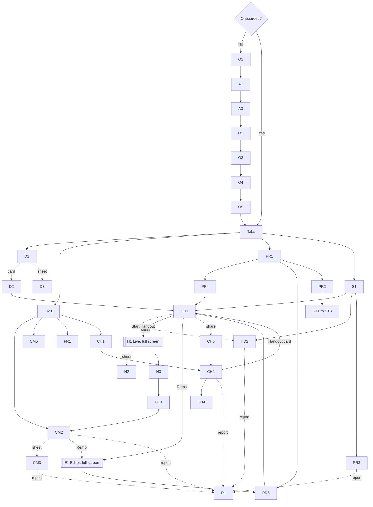

# Vybe: Information Architecture

Status: working spec (3 Nov 2026), not yet reviewed by mentors (open questions: section 8). Built from the team's decisions
(`docs/PRODUCT.md` section 4) and research into comparable apps and Apple's Human Interface Guidelines (HIG); sources at the end.
Information Architecture (IA) = which screens exist, how they are grouped, how you move between them, and what content they show.

---

## 1. Principles (each backed by research)

1. **Tabs are places, not actions.** HIG: "Use a tab bar to support navigation, not to provide actions." So there is no "+" tab.
   New Hangouts come from Remix or Drafts; posts come only from a finished Hangout (the Strava model: do it, then post it).
2. **Never hide or disable a tab.** HIG: "Don't disable or hide tab bar buttons… If a section is empty, explain why." Community
   exists from Phase 1 with an explained empty state. Adding a tab later is fine; removing one confuses people.
3. **One sheet at a time; long tasks go full-screen** (HIG, sheets and modality). The live Hangout and the editor are full-screen;
   small, quick choices are sheets.
4. **A SwiftUI sheet covers the tab bar**, so Discover cannot have an always-open Apple-Maps-style sheet (Apple Maps and Find My
   have no tab bar).
5. **Search lives in the Search tab**, Apple's search-role tab: on iOS 26+ (our minimum) it sits apart at the trailing end.
6. **Doing produces the post.** A Hangout you finish (fully or partly) becomes the thing you post (Strava, AllTrails, Komoot).
7. **Sharing out matters as much as chat.** Indian friend groups live on WhatsApp, so sharing a Hangout must work for people who
   don't have Vybe yet.

## 2. Tab bar

**Decided by the team: 4 tabs, the same in Phase 1 and the full app.**

```
┌──────────────────────────────────────────┬─────────┐
│  Discover     Community     Profile      │ Search  │
└──────────────────────────────────────────┴─────────┘
```

- **Discover, Community, Profile** are the three main tabs, in that order.
- **Search is a separate tab at the trailing end** (`Tab(role: .search)`): drawn apart from the other three and turning into the
  search field when tapped. Never in the middle.
- Phase 1: Community shows a friendly "Coming soon" empty state (explained, not hidden). Chat is **not a tab**; it lives inside Community.

Where other things live: **Chats** (DMs, groups), **Friends hub** (requests, "you might know", my friends) and **Activity** (likes,
comments, Remix credits, friend requests) are icons (chat, friends, bell) in Community's top bar. **Settings** is the gear on
Profile. **Badges:** unread chat count on the Community tab (HIG: badges for critical info only).

Considered and not chosen: a separate Chats tab (Instagram and Threads moved DMs into their tab bars in 2025). We keep 4 tabs so
Community is the one social place.

## 3. Content objects (what the screens show)

| Object | What it is | States |
|---|---|---|
| **Place** | a real venue on the map | approved, or suggested (pending, approved, rejected) |
| **Hangout** | the blueprint: 2 to 10 ordered Spots, budget range, time, tags | **Draft** (yours, private) or **Published** |
| **Spot** | one Place inside a Hangout, with order, minutes, note | |
| **Save** | your bookmark of someone's Hangout | (a link, not a Hangout state) |
| **HangoutRun** | one person doing a Hangout | **Live**, **Done** (not posted), **Posted** |
| **Visit** | "Mark visited" on one Spot during a run, with photos | |
| **Post** | a Posted HangoutRun, shown as a Community card | Public or Friends |
| **Comment, Like** | on posts (comments are threaded and can be liked) | |
| **User** | account and profile | public or private profile |
| **Friendship, FriendRequest, Block** | the social graph | request sent, received, friends |
| **Conversation, Message** | DMs and friend groups (3+); text, photo, Hangout, link, voice, poll | |
| **Report** | on a post, comment, user, message or Place | |

"Saved" is a **link** between you and a Hangout, not a Hangout state; "Draft" is a Hangout state; "Live, Done, Posted" are
HangoutRun states. Every field, ID rule and privacy rule is in `docs/DATA-MODEL.md` (photos belong to the run, each tagged with the
Spot it was taken at).

The entity-relationship diagram is in `docs/DATA-MODEL.md` section 3.

## 4. Screen inventory

Screen IDs are short code names used in branch names, PR titles and Figma frames (prefixes chosen not to clash with work-package IDs
C1, C2, K1, W1...). Presentation: **Root** (a tab's first screen), **Push** (slides in, back button), **Sheet** (slides up), **Full**
(full-screen cover), **Card** (overlay on the map), **Dialog** (system alert). Every data screen has 4 states unless noted:
**loading** (placeholder skeleton), **empty** (friendly line plus one action), **error** (retry), **offline** (last loaded content,
read-only, offline banner).

### Onboarding and sign-in
| ID | Screen | Purpose | From | Pres. | Phase |
|---|---|---|---|---|---|
| O1 | Welcome | pitch, "Get started", "I have an account" | first launch | Root | 1 |
| A1 | Sign in | Apple, Google or email | O1 | Push | 2 |
| A2 | Email sign-in | email, then code or password | A1 | Push | 2 |
| A3 | Account basics | unique username, date of birth, 18+ confirm | A1, A2 (new user) | Push | 2 |
| O2 | Name and photo | name, photo | O1 (P1), A3 (P2) | Push | 1 |
| O3 | Interests | pick 3 or more chips | O2 | Push | 1 |
| O4 | Location | explain, system prompt; if denied, pick an area | O3 | Push | 1 |
| O5 | Find friends | "you might know" | O4 | Push | 2 |

### Discover
| ID | Screen | Purpose | From | Pres. | Phase |
|---|---|---|---|---|---|
| D1 | Discover map | full-screen map, Hangout pins, filter chips, Picks row | tab | Root | 1 |
| D2 | Pin preview | Hangout card: photo, Spots count, budget, time; "See Hangout" | D1 pin | **Card** | 1 |
| D3 | Filters | budget, time, vibe, tags, category | D1 "More filters" | Sheet | 1 |

D2 is a **card overlay on the map**: it keeps the tab bar visible and the map usable (a sheet would cover the tab bar). Mentor
question 2 (section 8).

### Hangout
| ID | Screen | Purpose | From | Pres. | Phase |
|---|---|---|---|---|---|
| HD1 | Hangout detail | photo header, ordered Spots, mini-map; **Start Hangout**, Save, Share, Remix, more (•••) (Phase 1 shows only Start, Save and Share) | D2, S1, PR4, PR5, CM2, chat card, link | Push | 1 |
| HD2 | Spot sheet | one Place: photos, address, hours, Apple place details; trek safety note, monsoon banner and "closed by authorities" status | HD1, H1, S1 | Sheet (router `Sheet.spot`, because three features open it) | 1 |
| HD3 | Remix tree | "Remixed from @x" and Remixes of this one | HD1 credit line | Push | 2 |

HD2 also lists **"Hangouts with this Spot"** (up to 3 `HangoutCard`s): tapping one closes the sheet and opens HD1, which is how
Search › Place leads to Start Hangout. The Apple place-details sheet it can open (`mapItemDetailSheet`) is the one allowed
sheet-on-sheet.

### Editor (create and Remix)
| ID | Screen | Purpose | From | Pres. | Phase |
|---|---|---|---|---|---|
| E1 | Hangout editor | title, Spots (reorder, notes), budget, time, tags | Remix, Drafts | Full | 2 |
| E2 | Add Spot | choose a Place | E1 | Sheet | 2 |
| E3 | Suggest a Place | name, location, category, photo; reviewed by the team | E2 (pushed inside the E2 sheet), S1 empty (router `Sheet.suggestPlace`) | Push inside E2, or Sheet from Search | 2 |

### Live Hangout
| ID | Screen | Purpose | From | Pres. | Phase |
|---|---|---|---|---|---|
| H1 | Hangout live | big text, route line, current Spot, distance, time; minimise, end | HD1 Start | Full | 1 |
| H2 | Mark visited | confirm, nudge to add a photo | H1 | Sheet (small) | 1 |
| H3 | Summary | Spots visited, time, distance, photos; **Post** or "Not now" | H1 end | Push (inside Full) | 1 |
| H4 | Live mini-bar | return to a minimised live Hangout from any tab (`tabViewBottomAccessory`, iOS 26) | H1 minimise | bar above tabs | 2 |

### Posting
| ID | Screen | Purpose | From | Pres. | Phase |
|---|---|---|---|---|---|
| PO1 | Post composer | cover, title, caption, photos (max 2 × visited Spots), tags, audience (default Friends; Public shows a warning), "post in 30 min / 2 h / tomorrow"; disabled with a clear reason if fewer than 2 Spots were visited | H3, Profile "Ready to post" | Push (inside Full) | 2 |
| PO2 | Edit post | everything except the Spots; **delete post** (asks to confirm) | CM2 ••• | Sheet | 2 |

### Community
| ID | Screen | Purpose | From | Pres. | Phase |
|---|---|---|---|---|---|
| CM1 | Feed | friends first, then newest; a Trending section; Picks as cards | tab | Root | 1 (empty state) / 2 |
| CM2 | Post detail | visited Spots, photos, mini-map; like, comment, save, share, Remix | CM1, profiles, CM5 | Push | 2 |
| CM3 | Comments | threaded; like, delete, report | CM2 | Sheet (large) | 2 |
| CM4 | Trending | full list | CM1 "See all" | Push | 2 |
| CM5 | Activity | likes, comments, Remix credits, friend requests on top | bell icon | Push | 2 |
| FR1 | Friends hub | requests (received, sent, and an "Other" folder for requests with no mutual friends), "you might know", my friends | friends icon, CM5, PR1 | Push | 2 |

### Chats (inside the Community tab)
| ID | Screen | Purpose | From | Pres. | Phase |
|---|---|---|---|---|---|
| CH1 | Chats list | DMs and groups, unread counts | chat icon in Community's top bar | Push | 2 |
| CH2 | Conversation | text, photos, Hangout cards, links, voice, polls; read receipts | CH1, profile "Message" | Push | 2 |
| CH3 | New chat or group | pick friends (3+ for a group) | CH1 | Sheet | 2 |
| CH4 | Group info | rename, members, add, remove (admin), leave | CH2 header | Push | 2 |
| CH7 | Group invitation | "Alex added you to Kothrud Crew": Join / Leave and block (shown when the adder isn't your friend) | notification, CH1 | Sheet | 2 |
| CH5 | Share to… | friends and groups, plus "More…" (system share sheet, e.g. WhatsApp) | HD1, CM2 Share | Sheet (medium) | 2 |
| CH6 | Poll composer | "I'm in" / "Not for me" | CH2 | Sheet | 2 |

### Profile and Settings
| ID | Screen | Purpose | From | Pres. | Phase |
|---|---|---|---|---|---|
| PR1 | My profile | banner, photo, stats, posted Hangouts; Saved, Drafts, Ready-to-post | tab | Root | 1 |
| PR2 | Settings | root list | PR1 gear | Push | 1 (simple) |
| PR3 | Other person's profile | Add friend / Requested / Respond / Friends; mutual friends; posts; private gate | S1, CM2, FR1, CH4 | Push | 2 |
| PR4 | Saved | saved Hangouts (one you can no longer open shows "No longer available") | PR1 | Push | 1 |
| PR5 | Drafts | your Hangouts in progress; "New Hangout" | PR1 | Push | 1 (list) / 2 |
| PR6 | Edit profile | name, username, photo, **banner**, bio, **interests** (used for suggestions) | PR1 | Sheet | 2 |
| PR7 | Mutual friends | list | PR3 | Push | 2 |
| PR8 | Ready to post | your finished Hangouts you haven't posted yet (post or delete), and **Scheduled** posts ("Scheduled for 8:30 pm"; cancel) | PR1 | Push | 2 |
| ST1-ST7 | Settings pages | Account, Privacy (comments, who can send requests, who can add me to groups, show me in search, default audience), Blocked, Notifications, Help and contact (incl. grievance officer), My Place suggestions, About and credits | PR2 | Push | 2 |
| ST8 | Delete account | explain, re-confirm, delete (required by Apple). Also deletes `library.json`, run photos and `profile.json` from the phone, ends any live run, calls `router.reset()` and returns to O1. (Whether all of the person's photos are removed from the server is open in `OPEN-QUESTIONS.md`.) | ST1 | Push + Dialog | 2 |

ST1 (Account) also holds **Sign out**, **change area** and **reset onboarding**. PR2 in Phase 1 shows edit name and photo, change
area, reset onboarding and About.

### Search
| ID | Screen | Purpose | From | Pres. | Phase |
|---|---|---|---|---|---|
| S1 | Search | suggestions and recents when empty; results grouped Hangouts, Places, People, ordered by the tab you came from | tab | Root | 1 (no People) |
| S2 | See all | full list for one group | S1 | Push | 2 |

### Admin (hidden section in Settings, shown only to team accounts; the server enforces access)
| ID | Screen | Purpose | From | Phase |
|---|---|---|---|---|
| AD1 | Reports queue | open reports by severity (nudity, self-harm and threats auto-hidden first); hide, restore, warn, ban | PR2 (admin only) | 2 |
| AD2 | Place suggestions | review pending suggestions; approve into a Place, reject with a note; reject residential addresses | AD1 | 2 |
| AD3 | Users | look up a user, see reports, ban or unban | AD1 | 2 |

### Web (outside the app, version 1)
| ID | Page | Purpose | From | Phase |
|---|---|---|---|---|
| WEB1 | Shared Hangout / post page | public page with a WhatsApp preview (cover photo, title, budget, Spots list); "I'm in" without an account (type a name); "Get Vybe on iPhone" button; works on Android | the Share link (HD1, CM2) | 2 |

WEB1 shows what a post's audience allows: Public posts show fully; Friends-only posts show only "Ask your friend to invite you",
never the content.

### Safety and system
| ID | Screen | Purpose | From | Pres. | Phase |
|---|---|---|---|---|---|
| R1 | Report | reason, optional detail, sent; then "Also block?" | every ••• menu | Sheet (router `Sheet.report`), or a **push inside the current sheet** when opened from CM3 or HD2 | 2 |
| R2 | Block confirm | explains what blocking does | profile •••, R1, chat | Dialog | 2 |
| X1 | Offline banner | read-only notice (built in Phase 1, triggerable once there is a network in Phase 2) | everywhere | Overlay | 1 |

## 5. Navigation map



## 6. Key flows

1. **First launch (Phase 1):** O1 › O2 › O3 › O4 › D1. Phase 2 adds sign-in: O1 › A1 › (A2) › A3 › O2 › O3 › O4 › O5 › D1. Ask for
   notification permission later (first friend request or chat), not at sign-up.
2. **Discover to start:** D1 › filter chips or D3 › tap pin › D2 card › "See Hangout" › HD1 › (HD2) › **Start Hangout** › H1.
3. **Live to post:** H1 › Mark visited (H2, photo nudge) › repeat › End (confirm if Spots are left) › H3 › **Post** › PO1 (blocked
   under 2 visited, with reason) › the post is **scheduled** (30 minutes later by default, or 2 h / tomorrow) and the cover closes on
   Profile › Ready to post › "Scheduled for 8:30 pm"; at that time it becomes visible, CM2. "Not now" keeps the run as Done in
   Profile's "Ready to post". Phase 1: H3 › back to D1 (`router.show(nil, in: .discover)`).
4. **Remix:** HD1 or CM2 › Remix › a Draft is created › E1 (banner "Remixed from @x") › Done › PR5. Start it like any Hangout; it can
   be posted only after doing it.
5. **Share:** HD1 or CM2 › Share › CH5 (friends and groups first, "More…" for WhatsApp) › the card appears in CH2 › the friend taps
   it › HD1.
6. **Report and block:** ••• on anything › R1 › "Thanks" › "Also block @x?" › R2 › hidden immediately.

## 7. Coverage check (3 Nov): every decided feature has a home
Walked through `docs/PRODUCT.md` section 4.

| Feature | Screens | Data it needs |
|---|---|---|
| Onboarding, sign-in, 18+ check, find friends | O1-O5, A1-A3 | UserProfile, AccountPrivate |
| Discover map, pins, clustering, filters, Picks row | D1-D3 | Place, Hangout (isPick), applePlaceID |
| Hangout detail, Save, Share, Remix, credit line | HD1, HD3 | Hangout, Save, RemixCredit |
| Spot details incl. trek safety note | HD2 (router sheet) | Place |
| Create / edit / Remix a Hangout, Drafts, same-Place warning | E1-E3, PR5 | Hangout (draft), PlaceSuggestion |
| Start, Mark visited, photos, summary, offline-safe live run | H1-H4 | HangoutRun, LiveHangoutStore |
| Post (partial or complete), delay, audience, edit, delete | PO1, PO2, PR8 | HangoutRun, Photo |
| Feed, trending, Picks as posts, like, save, share, Remix | CM1, CM2, CM4 | HangoutRun, Like |
| Threaded comments, comment likes, delete | CM3 | Comment, Like |
| Activity, friend requests, "Other" requests | CM5, FR1 | Activity, FriendRequest |
| Friends, mutual friends, other profiles, private gate | FR1, PR3, PR7 | Friendship |
| DMs, groups, invitations, voice, photos, polls, read receipts, edit/delete | CH1-CH7 | Conversation, Membership, Message, PollVote |
| Search (Hangouts, Places, People; ranked by previous tab) | S1, S2 | all (on-device for content) |
| Profile, stats, banner, interests, Saved, Drafts, Ready to post | PR1, PR4-PR6, PR8 | UserProfile, Save |
| Settings, privacy, blocked list, notifications, grievance contact, account deletion, sign out | PR2, ST1-ST8 | UserProfile settings |
| Report, block, auto-hide | R1, R2 | Report, Block |
| Admin: reports, place suggestions, bans | AD1-AD3 | Report, PlaceSuggestion |
| Web page for Android friends | WEB1 | GuestResponse |
| Offline read-only | X1 | cached data |

Two rules this check produced: **the Spot sheet (HD2) is opened by three features and the post composer (PO1) from inside the live
cover**, so both are solved in the router design (`docs/ARCHITECTURE.md` 2.6: `Sheet.spot` and a separate stack per full-screen
cover); and **CM2's "Save" on a post saves the underlying Hangout** (Save is a link to a Hangout).

## 8. IA questions for mentors
1. **Chat inside Community:** with Chats, Friends and Activity all reached from Community's top bar, how do we keep it uncrowded?
2. **D2 pin preview:** card overlay (tab bar stays visible) or a sheet (covers the tab bar)?
3. **"Search only in the Search tab" vs pickers.** Add Spot (E2), pick friends (CH3) and share (CH5) need typing: is a small filter
   field inside a picker acceptable, or must it all go through the Search tab?
4. **Done-but-not-posted runs:** keep them in "Ready to post" forever, or expire them?
5. **When does a user's own Hangout appear publicly or on the map?** Only after its first posted run?
6. **Live Hangout while using other tabs:** worth building the mini-bar (H4), or keep the live screen full-screen only?
7. **Notifications:** bell in Community, or in Profile (Google Maps moved them to its "You" tab)?
8. **Search ranking by previous tab:** will people understand it without visible scopes?
9. **Links for people without the app:** is a web preview page for a shared Hangout needed (Partiful and Corner have one)? Likely
   important for WhatsApp sharing.
10. **Safety:** are one Report sheet everywhere, a Blocked list and in-app contact enough for App Store Review Guideline 1.2?

## Sources
Evidence links: `docs/SOURCES.md` (section "Information architecture").
